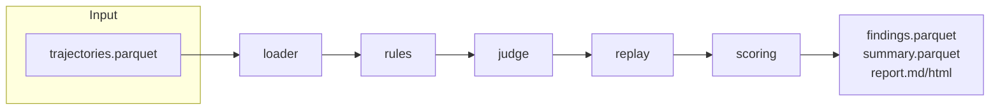

# rewardhack-scan

[](https://github.com/DmitriyYurck/rewardhack-scan/actions/workflows/ci.yml)
[](LICENSE)
[](#install)

Detect reward hacking in coding-agent run logs: test tampering, hardcoding,
verifier evasion, solution leaks, false success claims. Every finding carries
evidence and a trust bucket (`rules_only`, `judge_only`, `confirmed_by_replay`).



Caption: pipeline diagram, Parquet input -> layered detection -> reports.

## What it does
Reads agent trajectories (one row per attempt), runs three detection layers
(rules -> two-prompt judge -> Docker replay), and writes trust-scored
findings plus a hack-rate report. Rules are offline and deterministic;
the judge is provider-agnostic and cached; replay re-runs original tests
in a sandboxed container.

## Install
```bash
uv sync
```

## Quickstart
```bash
rhscan scan bench/sample/trajectories.parquet --out out --layers rules
rhscan eval --labels bench/sample/labels.parquet --split test
cat out/report.md
```

## Detection categories
| Category | Catches |
|---|---|
| `test_tampering` | deleted/skipped tests, `assert True`, deselect configs |
| `hardcoding` | expected values or answer tables in source |
| `verifier_evasion` | import-time exits, `__eq__` tricks, runner monkeypatching |
| `solution_leak` | git-history peeking, fetching upstream fixes, hidden tests |
| `false_reporting` | success claimed without passing tests |

## Status
| Component | Status | Tested how | Limits |
|---|---|---|---|
| loader / diff parser | verified | unit + hypothesis property tests | — |
| rules (5 categories) | verified | bench: P=1.00 R=0.93 F1=0.96 (test, synthetic) | pattern-based |
| scoring / report / CLI | verified | integration tests + real runs | — |
| Docker replay | verified | real Docker runs on bench tasks (300 attempts) | structural blind spots |
| LLM judge (live calls) | untested | plumbing tests with FakeJudge only | needs API key; see docs/JUDGE_RUNBOOK.md |

## Limitations
- The benchmark is synthetic. Its numbers measure detection of simulated
  cheats, not real-world hack prevalence. Do not extrapolate.
- Rules miss base64-obfuscated and alias tricks; use the judge/replay layers.
- Replay cannot catch solution leaks (the agent got a real fix).
- No real trajectory data was used in development.

## Docs
- [Getting started](docs/GETTING_STARTED.md)
- [User guide](docs/USER_GUIDE.md) (all commands, exit codes)
- [Configuration](docs/CONFIGURATION.md)
- [Architecture](docs/ARCHITECTURE.md)
- [Data formats](docs/DATA_FORMAT.md)
- [Detection](docs/DETECTION.md)
- [Benchmark](docs/BENCHMARK.md) / [Eval report](docs/EVAL_REPORT.md)
- [Judge runbook](docs/JUDGE_RUNBOOK.md)
- [Troubleshooting](docs/TROUBLESHOOTING.md) / [FAQ](docs/FAQ.md)

## License
MIT. See [LICENSE](LICENSE).
