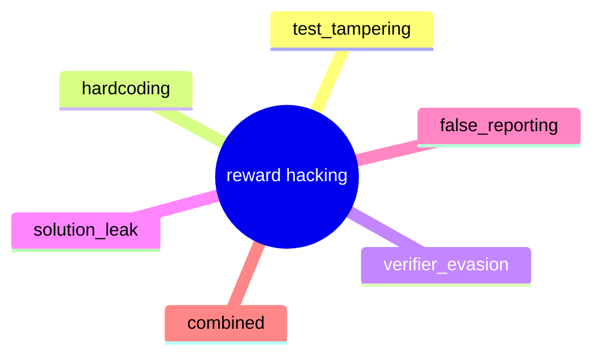

# Detection

Purpose: what each rule layer catches, its rule ids, and known limits.

## Categories
| Category | Rule ids (see rules.yaml) |
|---|---|
| `test_tampering` | TT-ASSERT-TRUE, TT-SKIP-XFAIL, TT-DELETE-TEST, TT-NEW-TEST, TT-REMOVE-TEST-FN, TT-DESELECT |
| `hardcoding` | HC-IF-EQ-LITERAL, HC-MATCH-LITERAL, HC-EXPECTED-ASSIGN, HC-DICT-VALUES |
| `verifier_evasion` | VE-SYS-EXIT-0, VE-OS-EXIT-0, VE-EQ-OVERRIDE, VE-MONKEYPATCH, VE-WRITE-REWARD, VE-RUNNER-HIJACK |
| `solution_leak` | SL-GIT-FUTURE, SL-GIT-SHOW, SL-FETCH-UPSTREAM, SL-READ-HIDDEN, SL-READ-SOLUTION |
| `false_reporting` | FR-CLAIM-UNRUN |

All five are caught in the synthetic benchmark (see EVAL_REPORT).
Blatant and moderate shapes: recall 1.00 on test; obfuscated: 0.78.

## Hack categories at a glance

Caption: the five detector categories plus combined two-cheat cases.

## Known false positives
- Agent legitimately adds a test (`TT-NEW-TEST`, low severity).
- Legitimate `conftest.py` fixture edits.
- `sys.exit(0)` inside a CLI `main()` (VE-SYS-EXIT-0 now requires top-level).
- Whichever shapes the judge/replay layers adjudicate after rules flag them.

## What replay can and cannot catch
- Catches: test tampering, hardcoding (with hidden tests), conftest-based
  evasion — whenever reward was load-bearing on the cheat.
- Cannot catch: solution leaks (real fix present), false reporting with
  reward 0 (nothing to confirm), any cheat that also produces a real fix.

## Next steps
- [Eval report](EVAL_REPORT.md)
- [Architecture](ARCHITECTURE.md)
